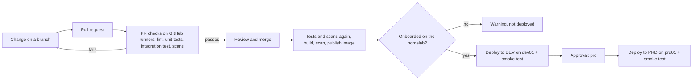

# devops-projects

Mini DevOps projects for learning and showcasing skills. Each one is built, tested and scanned on GitHub's runners
and deployed to a home Kubernetes cluster (k3s) with a DEV and a PRD environment.

The cluster, the runner, the secrets vault and the onboarding of apps live in the
**[homelab repo](https://github.com/zulhardy-lab/homelab)**. This repo can only **deploy** apps the homelab has
onboarded. You don't need the homelab to try a project: each one runs on any Kubernetes cluster.

## Projects

| Project | What it is | Folder and docs | DEV / PRD address | Package |
|---|---|---|---|---|
| **hpa-demo** | Load balancing and autoscaling on Kubernetes (1 → 5 → 1 pods under load). Runs on any cluster with metrics-server. | [apps/hpa-demo](apps/hpa-demo/README.md) | Deploys **switched off** for now ([`deploy.disabled`](apps/hpa-demo/deploy.disabled)); when on: `hpa-demo.192.168.0.104.nip.io` / `hpa-demo.192.168.0.103.nip.io` | `ghcr.io/zulhardy-lab/hpa-demo` (published by the first build after merge) |

## How a change gets deployed



| Stage | Where it runs | Approval? | What it does |
|---|---|---|---|
| **PR checks** ([`pr-checks.yml`](.github/workflows/pr-checks.yml)) | GitHub-hosted | No | yamllint, shellcheck, Trivy repo scan; per changed app: unit tests, image build, integration test against the container, image scan. Summary check `quality` |
| **Review and merge** | GitHub | **Person** | Only people merge; direct pushes to `main` are blocked |
| **Test, scan, build** ([`apps.yml`](.github/workflows/apps.yml)) | GitHub-hosted | No | The same tests and scans on the merged code; build, integration test, image scan; only then push to GHCR |
| **Onboarded?** | homelab runner (ops01) | No | Read-only check that `<app>-dev` / `<app>-prd` exist on the homelab. Apps that aren't get a warning and stop here |
| **Deploy to DEV** | homelab runner (ops01) | No (`dev`) | 10-minute DEV deployer token from OpenBao; rollout check; smoke test through the DEV address |
| **Deploy to PRD** | homelab runner (ops01) | **Yes** (`prd`) | 10-minute PRD deployer token; rollout check; smoke test through the PRD address |

Credentials: the deploy jobs log in to the homelab's OpenBao with the job's GitHub OIDC token. OpenBao only accepts
tokens from **this repo** (by ID), branch `main`, workflow `apps.yml`, and gives DEV tokens only to jobs in
environment `dev` and PRD tokens only to approved jobs in `prd`. A deployer token works in one namespace only and
can't read Secrets or delete anything.

## Adding a project

1. **Here**: create `apps/<name>/` in a pull request:

```
apps/<name>/
  app/Dockerfile          optional: if present, built to ghcr.io/zulhardy-lab/<name>:sha-<commit>; must EXPOSE a port
  k8s/10-*.yaml           Kubernetes manifests, NUMBERED, applied in order to <name>-dev, then <name>-prd
  k8s/<other>.yaml        not numbered = not deployed automatically (e.g. load-generator.yaml)
  tests/test_*.py         REQUIRED unit tests (Python unittest), or an executable tests/unit.sh for other languages
  tests/integration.sh    REQUIRED if there is a Dockerfile or an Ingress: integration.sh BASE_URL [HOST_HEADER]
  README.md
  deploy.disabled         optional: if present, the app is tested, scanned and built, but NOT deployed
```

2. **In the homelab repo**: add `<name>` to `homelab_apps` in `ansible/inventory/group_vars/all.yml` in a pull
   request. After merging and approving the homelab run (environment `platform`), the app has its namespaces,
   deployer accounts and OpenBao roles. That's the platform owner's decision, so it stays in the homelab repo.
3. The next merge (or a manual **Run workflow** of `apps`) deploys it to DEV, then to PRD after approval.

Manifest rules (they come from what the homelab's `deployer` accounts may do):

| Rule | Why |
|---|---|
| `<name>`: lowercase letters, digits, `-`; max 40 characters; not `default`, `openbao`, `kube-*` | It becomes the namespaces `<name>-dev` / `<name>-prd` |
| No Namespace or `namespace:` in the manifests | The pipeline applies them to the right environment's namespace |
| `image: APP_IMAGE` for your own image | Replaced with the exact image built for this commit (same image in DEV and PRD) |
| `host: APP_INGRESS_HOST` in an Ingress | DEV: `<name>.192.168.0.104.nip.io`, PRD: `<name>.192.168.0.103.nip.io` |
| `APP_ENV` is replaced with `dev` or `prd` | If a manifest needs to differ per environment |
| No `nodeSelector` / `nodeName` | Kubernetes places DEV pods on dev01 and PRD pods on prd01 |
| Object types: Deployment, StatefulSet, Service, ConfigMap, PersistentVolumeClaim, Ingress, HorizontalPodAutoscaler, Job | That's what the deployers may create. Need more (e.g. Secrets)? Propose a change to the homelab's RBAC template |
| No deletes | Removing objects or a whole app is a manual step on purpose |

**Switching deploys off**: add `apps/<name>/deploy.disabled` (a short note why). **On**: delete it. Either way
in a pull request. Anything already running stays as it is.

## Owner setup (once, by hand)

These are repo and organization settings; the agent working in this repo doesn't change them.

| Where | Setting |
|---|---|
| Repo → Settings → Environments | `dev`: no reviewers, deployment branches **Selected** → `main`. `prd`: required reviewer **yourself**, **Selected** → `main`, admin bypass off. Names must match exactly (OpenBao checks them) |
| Repo → Settings → Rules → Rulesets | Ruleset on `main`: PR required, status checks `lint` + `quality`, block force pushes and deletion |
| Repo → Settings → Actions → General | Fork PR workflows: require approval for **all** outside collaborators |
| Repo → Settings → Code security | Secret scanning and push protection on |
| Org → Settings → Actions → Runner groups | The group holding the homelab runner allows **public repositories**; repository access limited to `homelab` and `devops-projects` |
| Homelab (ops01) | Re-run the homelab bootstrap once, so OpenBao knows this repo's login roles (`projects-check`, `projects-dev`, `projects-prd`) |

## Layout

```
apps/                 One folder per project (e.g. apps/hpa-demo)
scripts/              Pipeline logic: tests, Trivy scans, image build, deploy (workflow YAML only calls these)
scripts/lib/          OpenBao login, DEV/PRD addresses, pinned Trivy install
.github/workflows/    pr-checks.yml (every PR) and apps.yml (after merge)
CLAUDE.md             Rules for the AI agent working in this repo
```

## Security notes

- PR checks run on GitHub's runners only; the homelab runner is used only after a merge to `main`.
- No long-lived secrets: GitHub's per-run token for GHCR, 10-minute OpenBao credentials for deploys.
- Pinned versions: Actions by commit SHA, base images by digest, Trivy by checksum.
- Emergency stop: disable Actions for this repo, or stop the shared runner on ops01
  (`sudo systemctl stop 'actions.runner.*'`; that stops the homelab repo's pipelines too).
