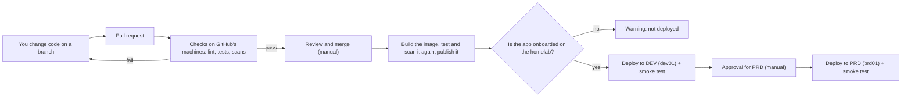

# devops-projects

Small DevOps projects for **learning and showcasing skills**. Each project is an app that is tested, scanned and
built automatically on GitHub, then deployed to a home Kubernetes cluster with two environments: **DEV** (for
trying things) and **PRD** (production, the "real" one).

This page explains, step by step, **how a change travels from your code to a running app**, and how to add a project
of your own. Every term is explained the first time it appears, and there's a word list below.

> You don't need the author's homelab to **try** a project: each one runs on any Kubernetes cluster, and its own
> README says how. The homelab is only needed for the automatic deploys described here.

## Contents

- [The projects](#the-projects)
- [Words you'll see](#words-youll-see)
- [The big picture](#the-big-picture)
- [How a change gets deployed, step by step](#how-a-change-gets-deployed-step-by-step)
- [How the pipeline logs in, without passwords](#how-the-pipeline-logs-in-without-passwords)
- [Add your own project](#add-your-own-project)
- [Rules for your Kubernetes files](#rules-for-your-kubernetes-files)
- [One-time setup of this repo](#one-time-setup-of-this-repo)
- [What's in this repo](#whats-in-this-repo)
- [Security notes](#security-notes)

## The projects

| Project | What you'll learn from it | Folder and guide | Image |
|---|---|---|---|
| **hpa-demo** | Load balancing and autoscaling on Kubernetes: pods go 1 → 5 → 1 as load rises and falls, shown live on a dashboard with a load slider. Runs on any cluster with metrics-server | [apps/hpa-demo](apps/hpa-demo/README.md) | `ghcr.io/zulhardy-lab/hpa-demo` |

## Words you'll see

| Word | Meaning |
|---|---|
| **Branch** | Your own copy of the code to change safely. `main` is the real one: whatever is on `main` gets deployed |
| **Pull request (PR)** | "Here are my changes, please add them to `main`." Checks run on it automatically |
| **Merge** | Add a PR's changes to `main`. In this repo, merging is done manually after the checks pass |
| **Pipeline / workflow** | A list of automatic steps GitHub runs (`.github/workflows/*.yml`) |
| **Runner** | The computer that runs a pipeline's steps. *GitHub-hosted* runners are GitHub's machines; the *homelab runner* is a VM at home (ops01) |
| **Image** | A packaged app, ready to run in a container. Stored in GitHub's registry, **GHCR** |
| **Kubernetes (k3s)** | Software that runs containers across several machines. k3s is a small version of it |
| **Namespace** | A separate area inside Kubernetes. Each app gets two: `<app>-dev` and `<app>-prd` |
| **Onboarding** | Giving an app its namespaces and permissions on the homelab. Done in the homelab repo, not here |
| **OpenBao** | The homelab's secrets vault. The pipeline gets short-lived deploy credentials from it |
| **Smoke test** | A quick check after a deploy that the app answers |
| **Trivy** | A scanner that looks for leaked secrets, unsafe settings and known vulnerabilities |

## The big picture



There are **two manual steps**: the review and merge, and the approval for PRD. Everything else runs by itself.

## How a change gets deployed, step by step

**Step 1: Open a pull request.** You change an app on a branch and open a PR. (New to branches and PRs? The
homelab-lite [laptop guide](https://github.com/zulhardy-lab/homelab-lite/blob/main/docs/LAPTOP.md) teaches it with
pictures.)

**Step 2: PR checks run** on GitHub's machines ([`pr-checks.yml`](.github/workflows/pr-checks.yml)), never at home:
- `lint`: checks the YAML and shell scripts are written correctly (yamllint, shellcheck);
- `repo-scan`: Trivy looks through the whole repo for secrets and unsafe settings;
- for each app you changed: its unit tests, an image build, an integration test against the running container, and
  an image scan;
- `quality`: passes only if all of the above passed.

✅ All green? Go on. Red? Open the failed check's log, fix it on the same branch, push again.

**Step 3: Review and merge (manual).** `main` is protected: you can't push to it directly, and a PR can only be
merged once `lint` and `quality` pass.

**Step 4: Build and publish** ([`apps.yml`](.github/workflows/apps.yml), on GitHub's machines). The same tests and
scans run again on the merged code. Then the image is built, tested and scanned, and only if all of that passes is
it pushed to GHCR, tagged with the commit it came from.

**Step 5: Onboarded?** The homelab runner (ops01) checks that the app's namespaces exist. If the app isn't onboarded
yet, you get a warning and it stops here: nothing is deployed.

**Step 6: Deploy to DEV.** No approval needed. The runner gets a 10-minute deploy credential from OpenBao, applies
the app's Kubernetes files to `<app>-dev` (pods run on dev01), waits for the rollout, and smoke-tests it through the
DEV address.

**Step 7: Approve PRD (manual).** The PRD job waits until it's approved in GitHub (**Actions** → the run → **Review
deployments**). Leave it unapproved if you only want DEV.

**Step 8: Deploy to PRD.** The same image as DEV, a 10-minute credential that only works in `<app>-prd` (pods on
prd01), a rollout check and a smoke test.

| Step | Where it runs | Approval? |
|---|---|---|
| PR checks | GitHub's machines | No |
| Review and merge | GitHub | **Manual** |
| Build, test, scan, publish | GitHub's machines | No |
| Onboarded? | Homelab runner (ops01) | No |
| Deploy to DEV | Homelab runner (ops01) | No (environment `dev`) |
| Deploy to PRD | Homelab runner (ops01) | **Manual** (environment `prd`) |

## How the pipeline logs in, without passwords

There are no stored passwords or keys for deploying. Instead:

1. Each pipeline run gets a short-lived **ID card from GitHub** (an *OIDC token*) that says which repo, branch,
   workflow and environment it is.
2. The deploy job shows that ID card to the homelab's **OpenBao**.
3. OpenBao checks it. It only accepts **this repo** (checked by its ID, so a renamed copy doesn't count), branch
   `main`, workflow `apps.yml`, and gives DEV credentials only to jobs in environment `dev`, and PRD credentials only
   to **approved** jobs in `prd`.
4. OpenBao hands back a Kubernetes credential that lasts **10 minutes** and works in **one namespace** only. It can
   create and update the app's objects, but it can't read Secrets or delete anything.

## Add your own project

**Step 1: Create the app's folder** under `apps/` in a pull request:

```
apps/<name>/
  app/Dockerfile          optional: if present, it's built into ghcr.io/zulhardy-lab/<name>:sha-<commit>; must EXPOSE a port
  k8s/10-*.yaml           Kubernetes files, NUMBERED: applied in order to <name>-dev, then <name>-prd
  k8s/<other>.yaml        not numbered = not deployed automatically (e.g. load-generator.yaml)
  tests/test_*.py         REQUIRED unit tests (Python unittest), or an executable tests/unit.sh for other languages
  tests/integration.sh    REQUIRED if there's a Dockerfile or an Ingress: integration.sh BASE_URL [HOST_HEADER]
  README.md               how to use it
  deploy.disabled         optional: if present, the app is tested, scanned and built, but NOT deployed
```

✅ The PR checks show a new `app (<name>)` check, and it passes.

**Step 2: Onboard it on the homelab.** In the **homelab repo**, add `<name>` to `homelab_apps` in
`ansible/inventory/group_vars/all.yml`, in a pull request. Merge it, then approve the homelab run (environment
`platform`). That creates the app's namespaces, its deploy accounts and its OpenBao roles. Why in the homelab repo?
Deciding which apps may run on the cluster is a platform decision, so it stays with the platform.

✅ In the homelab run's log, the onboarding step lists `<name>`.

**Step 3: Deploy it.** Merge any change to the app (or run the `apps` workflow by hand: **Actions** → **apps** →
**Run workflow**). It deploys to DEV, then to PRD once approved.

✅ The DEV smoke test passes, and the app answers at its DEV address.

**Switching deploys off and on:** add `apps/<name>/deploy.disabled` (with a short note why) to stop deploying; delete
it to start again. Do either in a pull request. Whatever is already running stays as it is.

## Rules for your Kubernetes files

The deploy accounts are only allowed to do certain things, so your files have to follow these rules:

| Rule | Why |
|---|---|
| `<name>`: lowercase letters, digits and `-`; up to 40 characters; not `default`, `openbao` or `kube-*` | It becomes the namespaces `<name>-dev` and `<name>-prd` |
| No `Namespace` objects and no `namespace:` lines | The pipeline puts each file into the right environment's namespace |
| `image: APP_IMAGE` for your own image | The pipeline swaps in the exact image built for this commit, so DEV and PRD run the same thing |
| `host: APP_INGRESS_HOST` in an Ingress | The pipeline swaps in the environment's web address |
| `APP_ENV` anywhere | Swapped for `dev` or `prd`, if a file has to differ between them |
| No `nodeSelector` / `nodeName` | Kubernetes already places DEV pods on dev01 and PRD pods on prd01 |
| Only these object types: Deployment, StatefulSet, Service, ConfigMap, PersistentVolumeClaim, Ingress, HorizontalPodAutoscaler, Job | That's what the deploy accounts may create. Need something else (e.g. a Secret)? Propose it in the homelab repo |
| Nothing gets deleted by the pipeline | Removing objects or a whole app is a manual step, on purpose |

## One-time setup of this repo

Done once, by hand, in GitHub's settings (the AI assistant working in this repo doesn't change settings):

| Where | What to set | Why |
|---|---|---|
| Repo → **Settings** → **Environments** | `dev`: no reviewers, deployment branches **Selected** → `main`. `prd`: required reviewer **yourself**, **Selected** → `main`, admin bypass **off**. The names must match exactly | This is what makes the PRD approval manual. OpenBao checks the names |
| Repo → **Settings** → **Rules** → **Rulesets** | A ruleset on `main`: pull request required, status checks `lint` and `quality`, block force pushes and deletion | Nothing reaches `main` without passing the checks |
| Repo → **Settings** → **Actions** → **General** | Fork pull request workflows: require approval for **all** outside collaborators | Strangers' PRs can't run pipelines without your OK |
| Repo → **Settings** → **Code security** | Secret scanning and push protection **on** | GitHub blocks pushes that contain secrets |
| Org → **Settings** → **Actions** → **Runner groups** | The group with the homelab runner allows **public repositories**, and only `homelab` and `devops-projects` | Only these two repos can use the runner at home |
| On the homelab (ops01) | Run the homelab bootstrap once more | So OpenBao knows this repo's login roles (`projects-check`, `projects-dev`, `projects-prd`) |

## What's in this repo

```
apps/                 One folder per project (e.g. apps/hpa-demo)
scripts/              What the pipelines actually do: tests, Trivy scans, image build, deploy
scripts/lib/          OpenBao login, DEV/PRD addresses, the pinned Trivy install
.github/workflows/    pr-checks.yml (every pull request) and apps.yml (after a merge)
CLAUDE.md             Rules for the AI assistant working in this repo
```

The workflow files are kept short on purpose: they only call the scripts in `scripts/`. That way the real logic can
be read, tested and moved to another CI system (e.g. Azure DevOps) without rewriting it.

## Security notes

- **Pull requests never run at home.** PR checks run on GitHub's machines; the homelab runner only runs after a
  merge to `main`.
- **No long-lived secrets.** Publishing images uses GitHub's per-run token; deploying uses 10-minute OpenBao
  credentials.
- **Everything is pinned.** Actions by commit SHA, base images by digest, Trivy by checksum, so a build can't
  silently pick up something different.
- **Emergency stop:** disable Actions for this repo, or stop the shared runner on ops01 with
  `sudo systemctl stop 'actions.runner.*'` (that also stops the homelab repo's pipelines).
