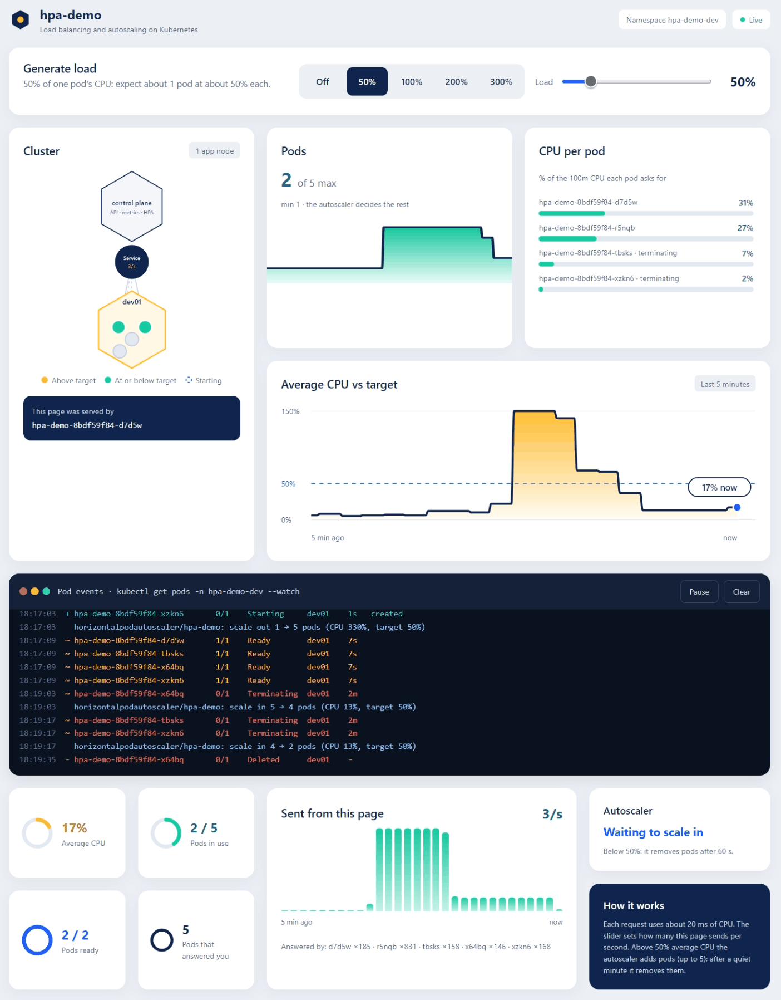
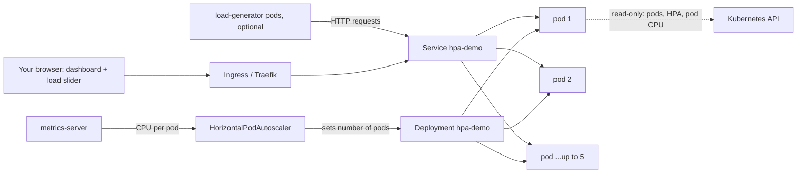
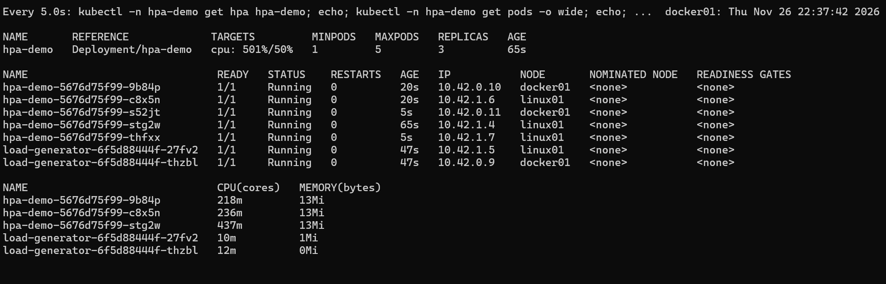
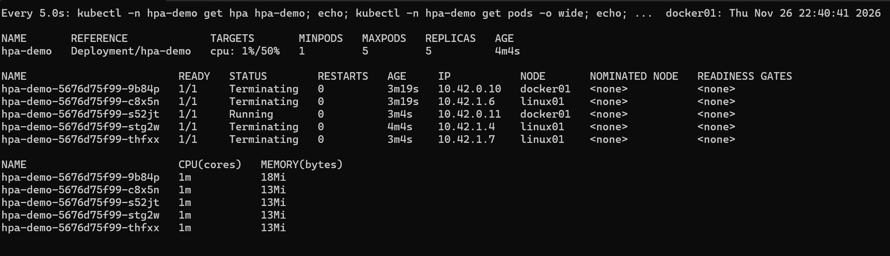
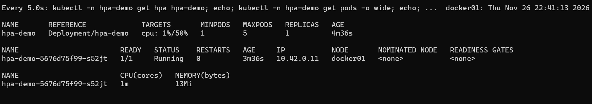

# hpa-demo: load balancing and autoscaling on Kubernetes

A small, self-contained demo you can run on **any Kubernetes cluster** in about 10 minutes.
It shows two things that cloud applications are usually asked to do:

1. **Load balancing:** spread incoming requests across several copies (pods) of an app.
2. **Autoscaling:** add pods automatically when traffic is high, and remove them when it drops.

The app is a tiny Python web server (standard library only). Every request makes it do some CPU work, and it
replies with the name of the pod that answered. Open it in a browser and you get a **live dashboard**: drag a
slider to create load, and watch Kubernetes add and remove pods.



*On the author's homelab (DEV), a few minutes after a run at 300%: the autoscaler scaled out from 1 to 5 pods
(CPU 330%), then back in to 2 once the load dropped. The Pod events console shows each step.*

On the author's homelab: **DEV** `http://hpa-demo.192.168.0.104.nip.io` (pods on dev01) and **PRD**
`http://hpa-demo.192.168.0.103.nip.io` (pods on prd01, after approval).

## Contents

- [What you'll learn](#what-youll-learn)
- [Words you'll see](#words-youll-see)
- [The dashboard](#the-dashboard)
- [How it fits together](#how-it-fits-together)
- [What you need](#what-you-need)
- [Run it: with the dashboard](#run-it-with-the-dashboard)
- [Run it: from the command line](#run-it-from-the-command-line)
- [Things you can change](#things-you-can-change)
- [Troubleshooting](#troubleshooting)
- [How it's built and deployed (on the author's homelab)](#how-its-built-and-deployed-on-the-authors-homelab)
- [Security choices](#security-choices)
- [Mapping to Azure](#mapping-to-azure)

## What you'll learn

- What **load balancing** looks like: one address, several pods sharing the work.
- What an **autoscaler** does: it watches CPU and adds or removes pods by itself, within limits you set.
- How to read the signs: pods starting and terminating, CPU against a target, the autoscaler's decisions.
- How a Kubernetes app is put together from a few small files (Deployment, Service, Ingress, autoscaler).

## Words you'll see

| Word | Meaning |
|---|---|
| **Pod** | One running copy of the app. More pods = more capacity |
| **Deployment** | Tells Kubernetes which app to run and keeps the right number of pods running |
| **Service** | One stable address in front of the pods. It spreads requests across them: that's the **load balancing** |
| **Ingress** | Lets your browser reach the Service from outside the cluster, by a web address |
| **HPA** (HorizontalPodAutoscaler) | The **autoscaler**: adds pods when they're busy, removes them when they're quiet |
| **metrics-server** | Measures each pod's CPU and memory, so the autoscaler knows how busy they are |
| **CPU request, `100m`** | How much CPU each pod asks for: 100 *millicores* = a tenth of one CPU core. "50% CPU" means 50% of that |
| **Namespace** | A separate area of the cluster. This demo uses `hpa-demo-dev` (or `hpa-demo-prd`) |
| **ServiceAccount** | An identity for the app's pods. `app-reader` lets the dashboard *read* (never change) its own namespace |

## The dashboard

| Part | What it shows |
|---|---|
| **Generate load** | Buttons for Off, 50%, 100%, 200% and 300%, and a slider from 0% to 300%. A line under them says what to expect |
| **Cluster** | A map: the Service in the middle, each node as a hexagon, each pod as a dot: amber above the CPU target, teal at or below it, dashed while starting. Hover over a dot for its name and CPU |
| **Pods** | How many pods are running (of the maximum 5), and a chart of the last 5 minutes |
| **CPU per pod** | One bar per pod, as a % of the 100m CPU each pod asks for |
| **Average CPU vs target** | The average CPU over the last 5 minutes, with the 50% target as a dashed line |
| **Pod events** | A terminal-style console, like `kubectl get pods --watch`: `+` pod created, `~` pod changed state (e.g. Starting → Ready, Ready → Terminating), `-` pod deleted, and a line each time the autoscaler changes its target (`scale out 1 → 3 pods`). Pause and Clear buttons |
| **Summary rings** | Average CPU, pods in use, pods ready, and how many different pods answered your requests |
| **Sent from this page** | The requests your page sent over the last 5 minutes, and which pods answered them: that's the load balancing |
| **Autoscaler** | What it's doing: Scaling out, Scaling in, Waiting to scale in, At the maximum, or Steady |

### What the load levels mean

The percentage is **how much CPU your page asks for, as a share of one pod's 100m** (a tenth of a CPU core). The
page sends small requests (`/burn`, about 20 ms of CPU each) at the matching rate: 100% is 5 requests a second,
300% is 15. The autoscaler aims for **50% per pod**, so:

| Level | Expect | Why |
|---|---|---|
| Off | 1 pod | Nothing to do; the minimum is 1 |
| 50% | 1 pod | Exactly the target |
| 100% | about 2 pods | 100 ÷ 50 |
| 200% | about 4 pods | 200 ÷ 50 |
| 300% | 5 pods, CPU stays above 50% | 300 ÷ 50 = 6, but the maximum is 5 |

Scaling out takes about 1–2 minutes (metrics-server measures every 15 s or so, then the pod has to start).
Scaling in waits 60 s below the target first. [Inference: these are typical timings on the author's k3s cluster;
yours may differ.]

The load **only runs while the page is open**, and every open page adds its own. Keep the tab in front: browsers
slow down timers in background tabs, so a hidden tab sends less load. [Inference: Chrome, Edge and Firefox all do
this, by different amounts.]

`curl`, `wget` and the load generator still get the plain-text reply, so the command-line demo works as before.

| Path | What it does |
|---|---|
| `/` | Browsers (`Accept: text/html`): the dashboard. Anything else: CPU work, then `OK from <pod>` |
| `/burn` | About 20 ms of CPU, then `{"pod": "<name>"}`. The dashboard's load uses this |
| `/api/state` | The pods, their CPU and creation time, and the autoscaler, as JSON (`"available": false` outside a cluster) |
| `/healthz` | `ok`, for Kubernetes' health checks |
| `/static/app.css`, `/static/app.js` | The dashboard's style and script; nothing else on disk is served |

## How it fits together



1. Your browser (or the load generator) sends requests to the **Service**, through the **Ingress**.
2. The Service spreads them across all ready pods (load balancing).
3. **metrics-server** measures each pod's CPU. Each pod asks for 100m CPU (a tenth of a core).
4. When the average goes above **50%** of that, the **HPA** adds pods, up to 5.
5. When the load stops, CPU drops. After a 60-second wait the HPA removes pods again, down to 1.
6. For the dashboard, whichever pod answers reads the pods, the HPA and pod CPU from the **Kubernetes API**, with a
   read-only account (`app-reader`) that can only look inside its own namespace.

| Requirement | Kubernetes piece | File |
|---|---|---|
| Something to scale | Deployment of the demo app | [`k8s/10-deployment.yaml`](../apps/hpa-demo/k8s/10-deployment.yaml) |
| Load balancing inside the cluster | Service | [`k8s/20-service.yaml`](../apps/hpa-demo/k8s/20-service.yaml) |
| Load balancing from outside, and the dashboard's address | Ingress (Traefik, built into k3s) | [`k8s/30-ingress.yaml`](../apps/hpa-demo/k8s/30-ingress.yaml) |
| Scale out when busy, scale in when quiet | HorizontalPodAutoscaler: 1 to 5 pods, target 50% CPU | [`k8s/40-hpa.yaml`](../apps/hpa-demo/k8s/40-hpa.yaml) |
| The dashboard's view of the cluster | ServiceAccount `app-reader` + read-only Role | [`k8s/rbac-app-reader.yaml`](../apps/hpa-demo/k8s/rbac-app-reader.yaml) (on the homelab: created by onboarding) |
| Traffic from the command line | Load generator (2 pods sending requests in a loop) | [`k8s/load-generator.yaml`](../apps/hpa-demo/k8s/load-generator.yaml) |

## What you need

- A Kubernetes cluster with **metrics-server** running. Some options:
  - **k3s**: metrics-server and Traefik are included. This is what the author used.
  - **minikube**: run `minikube addons enable metrics-server` first.
  - **kind**, **Docker Desktop** and others: install metrics-server yourself.
- `kubectl` connected to that cluster, with admin rights (`apps/hpa-demo/hpa-demo.sh deploy` creates a namespace and the
  read-only account). Check with `kubectl top nodes`: if it prints CPU and memory, you're ready.
- `git` and `bash`.
- About 1.5 CPU cores free in the cluster while the load test runs.

You do **not** need to build anything. The app image is public:
`ghcr.io/zulhardy-lab/hpa-demo`, built by this repo's pipeline.

```bash
git clone https://github.com/zulhardy-lab/devops-projects.git
cd devops-projects
```

## Run it: with the dashboard

**1. Deploy, with an Ingress so your browser can reach it** (k3s, or any cluster with Traefik):

```bash
APP_INGRESS_HOST=hpa-demo.<your-node-ip>.nip.io apps/hpa-demo/hpa-demo.sh deploy
```

[nip.io](https://nip.io) turns that name into the IP inside it, so no DNS setup is needed.
✅ It ends with `deployment "hpa-demo" successfully rolled out`.

No Traefik (minikube, kind)? Deploy with `SKIP_INGRESS=1`, then `kubectl -n hpa-demo-dev port-forward svc/hpa-demo 8080:80`
and open `http://localhost:8080`. The dashboard works, but [Inference] port-forward sends everything to **one** pod,
so you'll see the scaling but not the load balancing ("Answered by" shows one pod).

**2. Open `http://hpa-demo.<your-node-ip>.nip.io`** in your browser.
✅ The top right says **Live**, the map shows 1 pod, and Pod events lists it.

**3. Click 200%** and leave the tab open. Within 1–2 minutes:
- the pod turns amber (above 50%), the Autoscaler says **Scaling out**, and Pod events shows `scale out 1 → 4 pods`;
- new pods appear dashed (starting), then turn teal or amber when ready;
- "Answered by" lists several pods: the Service is spreading your requests.

**4. Click Off.** CPU drops, the Autoscaler says **Waiting to scale in**, and after about a minute Pod events shows
the extra pods `Terminating`, then `Deleted`. Back to 1 pod.

**5. Try 300%:** it stops at 5 pods and the Autoscaler says **At the maximum**: the limit you set in the HPA.

**6. Clean up:** `apps/hpa-demo/hpa-demo.sh delete` (see below).

## Run it: from the command line

The original demo, with no browser needed.

**1. Deploy** (`SKIP_INGRESS=1` if your cluster has no Traefik)

```bash
SKIP_INGRESS=1 apps/hpa-demo/hpa-demo.sh deploy
```

✅ It ends with `deployment "hpa-demo" successfully rolled out`.

**2. Check it answers**

```bash
apps/hpa-demo/hpa-demo.sh test
```

This runs a short-lived pod inside the cluster that sends 10 requests. With 1 pod, every reply has the same name:

```
OK from hpa-demo-5676d75f99-s52jt
OK from hpa-demo-5676d75f99-s52jt
...
```

**3. Start the load and watch it scale out**

```bash
apps/hpa-demo/hpa-demo.sh load-start
apps/hpa-demo/hpa-demo.sh watch
```

✅ Within 1 to 2 minutes, `TARGETS` climbs well above 50% and pods are added until there are 5.
Press `Ctrl+C` to stop watching. The load keeps running.

**4. See the load balancing**

```bash
apps/hpa-demo/hpa-demo.sh test
```

✅ Now the replies come from **different pods**: the Service is spreading the requests.

**5. Stop the load and watch it scale back in**

```bash
apps/hpa-demo/hpa-demo.sh load-stop
apps/hpa-demo/hpa-demo.sh watch
```

✅ CPU drops to near 0%. After about a minute the extra pods show `Terminating`, and it goes back to 1 pod.

**6. Clean up**

```bash
apps/hpa-demo/hpa-demo.sh delete
```

This removes the whole `hpa-demo-dev` namespace and everything in it. (On the author's homelab it refuses:
there the namespace is managed by the pipeline.)

The scripts work in namespace `hpa-demo-dev` by default. Set `HPA_DEMO_ENV=prd` to use `hpa-demo-prd` instead.

### What the command-line demo looked like

From an earlier version of the homelab (2 nodes, namespace `hpa-demo`, before the dashboard existed).

**Under load:** CPU at 501% of target, the HPA has scaled from 1 to 5 pods, spread across both nodes.



**Load stopped:** CPU at 1%, the extra pods are terminating.



**Back to 1 pod**, about 4 minutes after the test started.



## Things you can change

| What | Where | Default |
|---|---|---|
| Min / max pods | `minReplicas`, `maxReplicas` in [`k8s/40-hpa.yaml`](../apps/hpa-demo/k8s/40-hpa.yaml) | 1 / 5 |
| CPU target | `averageUtilization` in [`k8s/40-hpa.yaml`](../apps/hpa-demo/k8s/40-hpa.yaml) | 50% |
| How fast it scales back in | `stabilizationWindowSeconds` in [`k8s/40-hpa.yaml`](../apps/hpa-demo/k8s/40-hpa.yaml) | 60s (Kubernetes default is 300s) |
| CPU each pod asks for | `resources.requests.cpu` in [`k8s/10-deployment.yaml`](../apps/hpa-demo/k8s/10-deployment.yaml). Change `CPU_REQUEST_MILLICORES` (env var) and `REQUEST_M` in [`app/static/app.js`](../apps/hpa-demo/app/static/app.js) to match | 100m |
| CPU per dashboard request | `BURN_MS` env var on the Deployment, and `BURN_MS` in [`app/static/app.js`](../apps/hpa-demo/app/static/app.js) to match | 20 ms |
| CPU work per plain-text request | `CPU_WORK_ITERATIONS` env var on the Deployment | 1000000 |
| Load from the command line | `replicas` in [`k8s/load-generator.yaml`](../apps/hpa-demo/k8s/load-generator.yaml) | 2 |
| Highest load level on the page | `max="300"` in [`app/static/index.html`](../apps/hpa-demo/app/static/index.html) and `LEVELS` in `app.js` | 300% |

## Troubleshooting

| You see | Likely cause | What to do |
|---|---|---|
| Dashboard: **No cluster data: Not running in Kubernetes** | The app runs outside a cluster (e.g. `python app.py` on your laptop) | Expected. The load still works; the cluster parts stay empty |
| Dashboard: **No cluster data: Can't read the Kubernetes API** | The `app-reader` account or its Role is missing | `kubectl -n hpa-demo-dev auth can-i list pods --as=system:serviceaccount:hpa-demo-dev:app-reader` should say `yes`. If not, re-run `apps/hpa-demo/hpa-demo.sh deploy` (own cluster) or the homelab's onboarding (homelab) |
| Dashboard: CPU shows `…`, Average CPU stays empty | metrics-server not installed or still starting | `kubectl top pods -n hpa-demo-dev`. Wait a minute, or install metrics-server |
| Dashboard: load is on but nothing scales | The tab is in the background (browsers slow it down), or the level is 50% or less | Keep the tab in front, and pick 100% or more |
| Dashboard: "Answered by" shows only one pod | You're using `kubectl port-forward`, which goes to one pod | Use the Ingress address to see the load balancing |
| `TARGETS` shows `<unknown>` | metrics-server not installed or still starting | Check `kubectl top pods -n hpa-demo-dev`. Wait a minute, or install metrics-server |
| Pods stuck in `ImagePullBackOff` | Cluster can't reach `ghcr.io` | Check the nodes have internet access |
| No pods at all; `kubectl -n hpa-demo-dev get events` shows `serviceaccount "app-reader" not found` | The read-only account wasn't created | Deploy with `apps/hpa-demo/hpa-demo.sh deploy`, which creates it on your own cluster |
| Pods stay `Terminating` for about 30 seconds | The app doesn't handle the stop signal (SIGTERM), so Kubernetes waits for its 30 s grace period | Harmless in this demo |
| `scripts/image-tag.sh` says no commit found | The repo was cloned with `--depth 1` | Clone normally (full history), or set `APP_IMAGE` yourself |
| Pods never go above 1 | Not enough load, or the cluster is out of CPU | Raise the level (or `replicas` in the load generator); check `kubectl describe hpa -n hpa-demo-dev` |

## How it's built and deployed (on the author's homelab)

You don't need any of this to **try** the demo: on your own cluster, `apps/hpa-demo/hpa-demo.sh deploy` uses your own
kubeconfig. This section is about how the author's homelab deploys it automatically. The full story, step by step,
is in this repo's [README](../README.md#how-a-change-gets-deployed-step-by-step).

**Before the first deploy:** hpa-demo had to be **onboarded** on the homelab, i.e. added to `homelab_apps` in the
[homelab repo](https://github.com/zulhardy-lab/homelab). Onboarding creates its namespaces (`hpa-demo-dev`,
`hpa-demo-prd`), its deploy accounts, and the dashboard's read-only `app-reader` account
([`app-deployer-rbac.yaml.tmpl`](https://github.com/zulhardy-lab/homelab/blob/main/ansible/files/k8s/app-deployer-rbac.yaml.tmpl)).

**Every time a change under `apps/hpa-demo/` is merged:**

1. **Test and scan** (GitHub's machines): the unit tests in [`tests/test_app.py`](../apps/hpa-demo/tests/test_app.py) and a Trivy scan
   of the repo.
2. **Build** (GitHub's machines): [`scripts/build-image.sh`](../scripts/build-image.sh) builds
   `ghcr.io/zulhardy-lab/hpa-demo:sha-<last commit that changed apps/hpa-demo/app>`, runs
   [`tests/integration.sh`](../apps/hpa-demo/tests/integration.sh) against the container (the plain-text reply, the dashboard page,
   `/burn`, `/api/state`, 404s), scans the image, and only then publishes it.
3. **DEV** (the homelab runner on ops01, no approval): a 10-minute credential that only works in `hpa-demo-dev`,
   [`scripts/deploy.sh hpa-demo dev`](../scripts/deploy.sh), a rollout check, then `integration.sh` again against
   `http://hpa-demo.192.168.0.104.nip.io`. The pods run on dev01.
4. **PRD** (approval done manually): the same image, a credential that only works in `hpa-demo-prd`, pods on prd01,
   and a smoke test against `http://hpa-demo.192.168.0.103.nip.io`.

Only the **numbered** files in `k8s/` are deployed. `load-generator.yaml` and `rbac-app-reader.yaml` aren't: the load
test stays a manual step, and the read-only account comes from onboarding.

## Security choices

- Base images (`python:3.13-slim`, `busybox:1.37`) are **pinned by digest**, so a rebuild can't silently pick up a different image.
- The app runs as a **non-root** user, with a **read-only filesystem**, **no Linux capabilities**, and no privilege escalation.
- The pipeline only gets `contents: read` and `packages: write`, for that one run.
- The dashboard's account is **read-only, in its own namespace only** (pods, autoscaler, pod CPU). No Secrets, no
  writes. The load buttons are plain HTTP requests, and the autoscaler creates and removes pods with its own built-in
  permissions: nothing on the page can change the cluster.
- The page is served with a strict **Content-Security-Policy** (`default-src 'self'`: no inline scripts, no outside
  fonts or scripts), and everything it shows from the server is set as text, never as HTML.
- `/burn` uses a fixed slice of CPU; a request can't ask for more. `/api/state` is cached for a second per pod, so
  many open pages don't flood the Kubernetes API. Only the listed static files are served.
- The Pod events console is worked out in the browser from the same updates, so it needs no extra permissions (such as
  reading cluster events).

## Mapping to Azure

Useful for comparing this homelab demo with an Azure design:

| Here (Kubernetes / k3s) | Azure App Service | Azure Kubernetes Service (AKS) |
|---|---|---|
| Service + Ingress | Built-in load balancing across instances | Service + Azure Load Balancer / Application Gateway |
| HorizontalPodAutoscaler | Autoscale rules (scale out/in on CPU or other metrics) | The same HPA, plus the cluster autoscaler for adding nodes |
| metrics-server | Azure Monitor metrics | metrics-server / Azure Monitor |
| `app-reader` (read-only ServiceAccount + Role) | Managed identity with a Reader role | Workload identity, or a ServiceAccount + Role as here |
